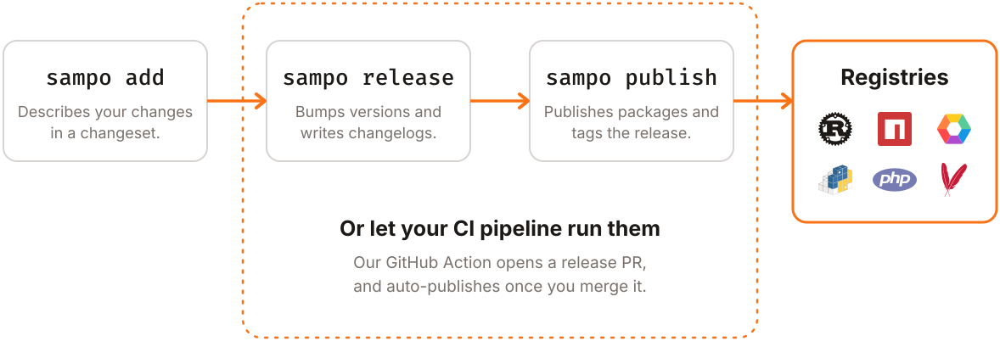

<picture>
  <source media="(prefers-color-scheme: dark)" srcset="./.github/assets/Sampo_logo_dark.svg" />
  
</picture>

> Steers his mighty boat in safety, Through the perils of the whirlpool, Through the watery deeps and dangers.

Automate changelogs, versioning, and publishing—even for monorepos across multiple package registries. Currently supported ecosystems: Rust ([Crates](https://crates.io)), JavaScript/TypeScript ([npm](https://www.npmjs.com)), Elixir/Gleam/Erlang ([Hex](https://hex.pm)), Python ([PyPI](https://pypi.org)), PHP ([Packagist](https://packagist.org)), Java ([Maven Central](https://central.sonatype.com)), Ruby ([RubyGems](https://rubygems.org))... And more [coming soon](https://github.com/bruits/sampo/issues/104)!

Don't know where to start? Check out Sampo's [documentation](./crates/sampo/README.md) or join us on [Discord](https://discord.com/invite/84pd4QtmzA)!

<picture>
  <source media="(prefers-color-scheme: dark)" srcset="./.github/assets/workflow_dark.svg" />
  
</picture>

## Acknowledgements

Sampo is deeply inspired by [Changesets](https://github.com/changesets/changesets) and [Lerna](https://github.com/lerna/lerna), but made with Rust and designed for multi-ecosystem monorepos. Read more about Sampo's [alternatives](./crates/sampo/README.md#alternatives).

Sampo also builds on the work of these open-source projects:

- Knope's [changesets](https://github.com/knope-dev/changesets) crate, which parses changeset files. [Knope](https://github.com/knope-dev/knope) is another Rust project inspired by Changesets, well worth a look
- [Semantic Versioning](https://semver.org/), whose `MAJOR.MINOR.PATCH` format and version bumps Sampo uses and enforces

Thank you to everyone who contributes, or would like to. [CONTRIBUTING.md](./CONTRIBUTING.md) is the place to start.

Sampo's name and quote honour the importance Finland took in my recent life.

Sampo is an open-source project born from [Bruits](https://bruits.org/), a Rust-focused collective 💛
